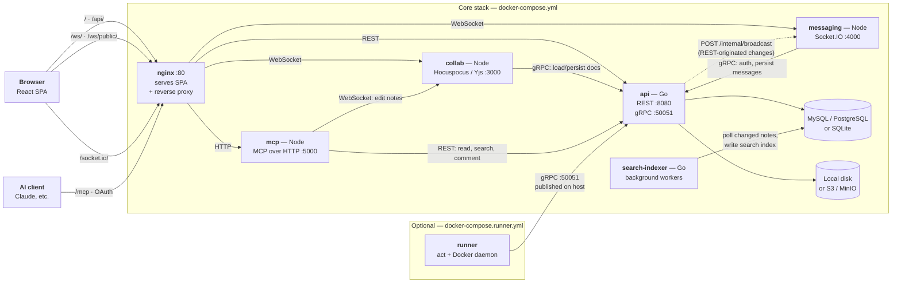

<div align="center">


# Notomate

*Note + automate.*

Self-hosted, all-in-one note-taking app with a built-in GitHub-Actions-style workflow automation engine.

**English** · [繁體中文](./README.zh-TW.md)

</div>

Write anything, anywhere — from a quick memo to a full blog post. The block-based editor supports rich text, media, and embeds. A built-in workflow engine automates your notes too: schedule AI digests, aggregate external data, or trigger notifications. Self-hosted, so your data stays yours.

## Installation

### Docker Compose (recommended)

```bash
git clone https://github.com/notomate/notomate.git
cd notomate
cp .env.example .env   # set APP_SECRET and the MySQL passwords (also in DB_DSN)
docker compose up -d
```

The app will be available at `http://localhost:8080`. All settings live in `.env` — see the comments in [`.env.example`](./.env.example) for the full list, including PostgreSQL / SQLite (`DB_DRIVER` / `DB_DSN`) and S3 storage.

The six app services are all required — `collab` backs the realtime editor, `messaging` backs channel chat, `mcp` serves AI clients, `search-indexer` keeps note search current, and nginx proxies to collab, messaging and mcp.

### Connecting AI clients (MCP)

Notomate serves an [MCP](https://modelcontextprotocol.io) endpoint at `/mcp`, so AI clients can search, read and edit notes, comment, and post to channels as you. Edits go through the realtime editor, so they are safe while people are working on the same note. Set `APP_PUBLIC_URL` in `.env` to your instance's public URL.

- **claude.ai and the mobile apps:** add a custom connector with the URL `https://<your-host>/mcp` and approve it when asked to sign in.
- **Claude Code:** `claude mcp add --transport http notomate https://<your-host>/mcp` and sign in with `/mcp`, or create a key under **Settings → API Keys** and add `--header "Authorization: Bearer ntp_..."`.

Connections are read-only unless you choose otherwise, and can be removed under **Settings → API Keys**.

## Architecture



| Service | Role |
| --- | --- |
| **nginx** | Single entrypoint on `:80`. Serves the built SPA and reverse-proxies `/api/` to api, `/ws/` + `/ws/public/` to collab, `/socket.io/` to messaging, `/mcp` to mcp. |
| **api** | Go backend and the only writer to the database and object storage. Serves the REST API, plus a gRPC service that collab, messaging and the runner call. Whenever a note or its comments change, it flags the note's search index as stale for search-indexer. |
| **collab** | Hocuspocus/Yjs server for realtime, multi-cursor note editing. Stateless — it loads and persists documents through the api's gRPC service. |
| **messaging** | Socket.IO server for channel chat and presence. Sockets are scoped to one channel; messages are persisted via gRPC to api. Room state is in-memory, so run exactly one replica. |
| **mcp** | [MCP](https://modelcontextprotocol.io) server for AI clients. Stateless — it calls the api's REST API with the client's token and edits notes through collab, so edits merge with people typing live. See [Connecting AI clients](#connecting-ai-clients-mcp). |
| **search-indexer** | Builds the search index of each note's text, tags and locations that the api's `/search` endpoints query. Polls the database for notes the api flagged and re-indexes them with a pool of workers, so changes are searchable within seconds; runs apart from the api so indexing load or a crash never affects it. Tune with `SEARCH_WORKERS`, `SEARCH_SCAN_INTERVAL_SECONDS` and `SEARCH_BATCH_SIZE`. The api runs the migrations, so start the api first after an upgrade. |
| **runner** | Optional workflow executor, in its own compose project. Long-polls api over gRPC for queued jobs and runs each one in a container via [act](https://github.com/nektos/act). |

## Contributing

Contributions are welcome! Fork the repo, create a feature branch, and open a pull request.

## License

Notomate is licensed under the **MIT License**.
