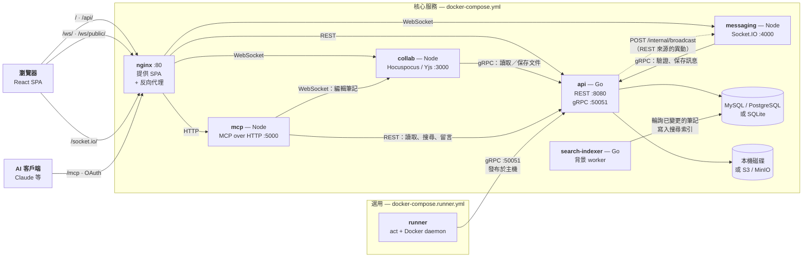

<div align="center">


# Notomate

*筆記（note）+ 自動化（automate）。*

可自行架設、功能完整的筆記軟體，內建類似 GitHub Actions 的工作流自動化引擎。

[English](./README.md) · **繁體中文**

</div>

隨手記下任何內容 — 從一則短短的備忘到一篇完整的部落格文章都行。以區塊（block）為基礎的編輯器支援富文本、媒體、嵌入等內容。內建工作流引擎讓筆記也能自動化：排程 AI 摘要、彙整外部資料，或觸發通知。完全自行架設，資料始終屬於你自己。

## 安裝

### Docker Compose（推薦）

```bash
git clone https://github.com/notomate/notomate.git
cd notomate
cp .env.example .env   # 設定 APP_SECRET 與 MySQL 密碼（DB_DSN 內的也要改）
docker compose up -d
```

啟動後即可於 `http://localhost:8080` 存取應用程式。所有設定都在 `.env` 裡，完整選項請參閱 [`.env.example`](./.env.example) 的註解，包含改用 PostgreSQL / SQLite（`DB_DRIVER` / `DB_DSN`）與 S3 儲存。

六個應用服務都是必要的 —— `collab` 支撐即時協作編輯器，`messaging` 支撐頻道聊天，`mcp` 提供 AI 客戶端連線，`search-indexer` 讓筆記搜尋保持最新，nginx 會反向代理到 collab、messaging 與 mcp。

### 連接 AI 客戶端（MCP）

Notomate 在 `/mcp` 提供 [MCP](https://modelcontextprotocol.io) 端點，讓 AI 客戶端能以你的身分搜尋、閱讀與編輯筆記、留言，以及在頻道中發訊息。編輯會經過即時協作編輯器，所以即使有人正在編輯同一份筆記也能安全合併。請在 `.env` 將 `APP_PUBLIC_URL` 設為此實例的公開網址。

- **claude.ai 與行動版 App：** 新增自訂連接器，URL 填 `https://<your-host>/mcp`，並在要求登入時同意授權。
- **Claude Code：** 執行 `claude mcp add --transport http notomate https://<your-host>/mcp` 後用 `/mcp` 登入；或在 **設定 → API 金鑰** 建立金鑰，並加上 `--header "Authorization: Bearer ntp_..."`。

除非你另外選擇，連線預設為唯讀，可在 **設定 → API 金鑰** 中移除。

## 架構



| 服務 | 職責 |
| --- | --- |
| **nginx** | 唯一入口（`:80`）。提供打包好的 SPA，並將 `/api/` 反向代理到 api、`/ws/` 與 `/ws/public/` 到 collab、`/socket.io/` 到 messaging、`/mcp` 到 mcp。 |
| **api** | Go 後端，也是唯一會寫入資料庫與物件儲存的服務。提供 REST API，以及給 collab、messaging、runner 呼叫的 gRPC 服務。筆記或其留言一有變更，就會把該筆記的搜尋索引標為過期，交給 search-indexer 重建。 |
| **collab** | Hocuspocus/Yjs 伺服器，負責即時多人協作編輯。本身無狀態 —— 透過 api 的 gRPC 服務讀取與保存文件。 |
| **messaging** | Socket.IO 伺服器，負責頻道聊天與線上狀態。每條連線只綁定單一頻道，訊息透過 gRPC 交由 api 保存。房間狀態存於記憶體，因此只能跑單一副本。 |
| **mcp** | 給 AI 客戶端使用的 [MCP](https://modelcontextprotocol.io) 伺服器。本身無狀態 —— 以客戶端的 token 呼叫 api 的 REST API，並透過 collab 編輯筆記，因此能和正在即時編輯的使用者安全合併。詳見[連接 AI 客戶端](#連接-ai-客戶端mcp)。 |
| **search-indexer** | 把每份筆記的文字、標籤與地點座標建成搜尋索引，供 api 的 `/search` 端點查詢。定期從資料庫找出 api 標記過的筆記，由 worker pool 重建索引，變更在數秒內就能被搜到；與 api 分開執行，索引負載或當掉都不會影響 api。可用 `SEARCH_WORKERS`、`SEARCH_SCAN_INTERVAL_SECONDS`、`SEARCH_BATCH_SIZE` 調整。migration 由 api 執行，升級後請先啟動 api。 |
| **runner** | 選用的工作流執行器，自成一個 compose 專案。透過 gRPC 向 api 長輪詢排隊中的 job，並以 [act](https://github.com/nektos/act) 在容器中執行。 |

## 貢獻

歡迎貢獻!Fork 此專案、建立功能分支，然後發起 Pull Request。

## 授權

Notomate 採用 **MIT 授權條款**。
